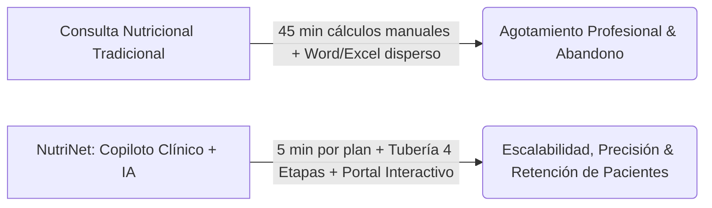
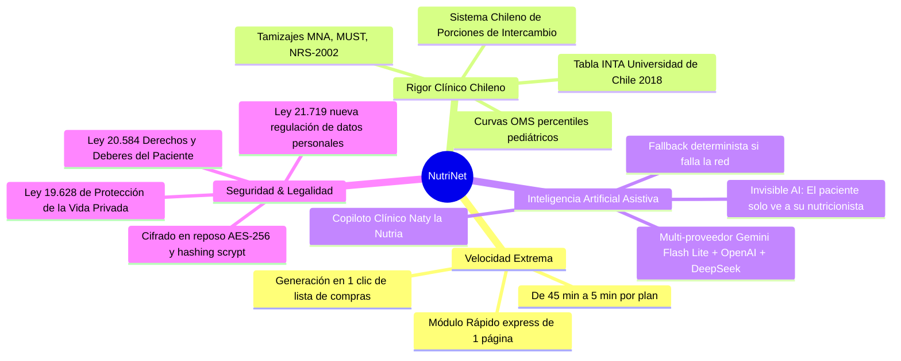
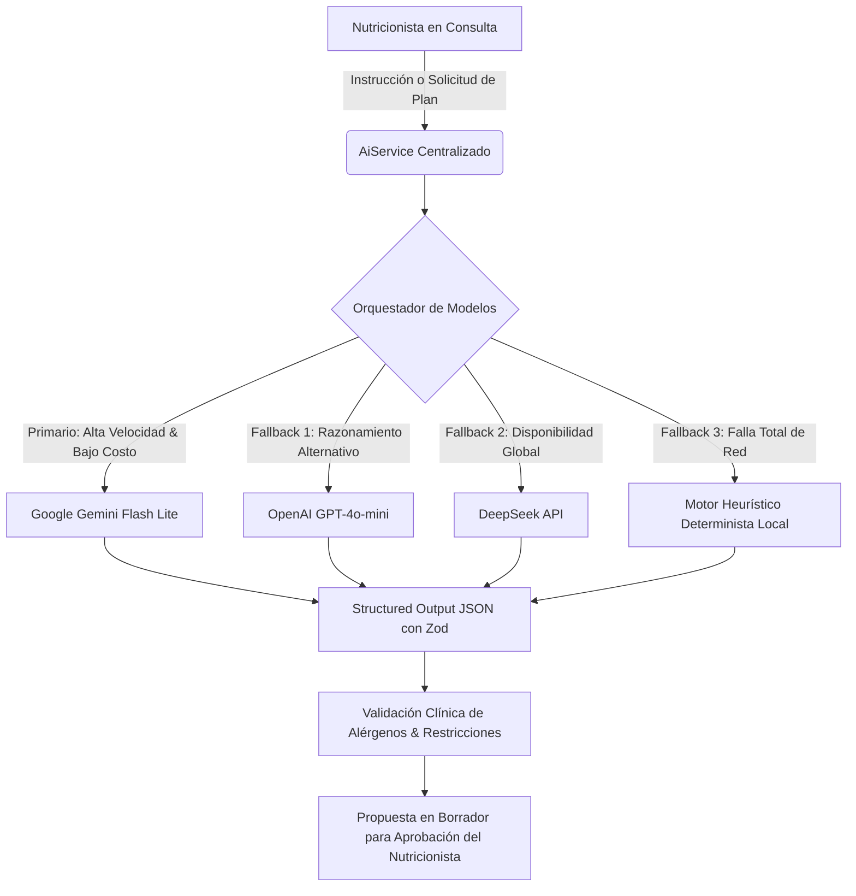
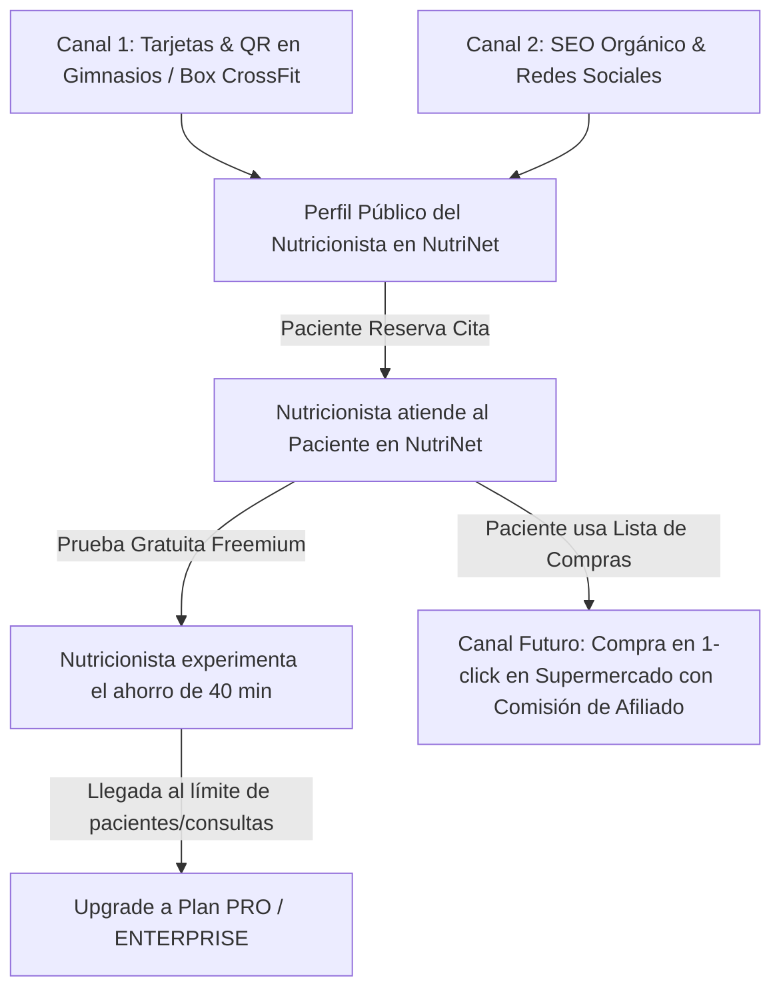

# NutriNet — Documento Maestro y Contexto Integral del Sistema
> **Documento Oficial de Arquitectura, Valor de Negocio, Ecosistema Clínico y Plataforma de Agentes de IA.**  
> *Versión 2.0 | Ámbito: Producción y Desarrollo | Localización: Chile & Latinoamérica*

---

## 🌟 1. Manifiesto y Visión Ejecutiva

### ¿Qué es NutriNet?
**NutriNet** es la plataforma SaaS clínica y **Copiloto Inteligente** de última generación diseñada en Chile específicamente para empoderar a los profesionales de la nutrición (nutricionistas clínicos, deportivos, pediátricos e institucionales). Combina rigor bio-matemático local, automatización de flujos de trabajo, gestión médica integral y modelos avanzados de Inteligencia Artificial que operan como un asistente invisible, liberando al profesional de la sobrecarga administrativa para centrarse en lo que verdaderamente transforma vidas: **la relación humana y la adherencia del paciente**.



### El Elevator Pitch
> *"Los nutricionistas en Chile pasan hasta el 60% de su jornada calculando calorías a mano, cuadrando porciones en planillas de Excel desactualizadas y diseñando PDFs en Word a las 10 de la noche. **NutriNet transforma ese proceso de 45 minutos en un flujo automatizado de 5 minutos**, utilizando la Tabla de Composición de Alimentos del INTA (Universidad de Chile), porciones de intercambio chilenas y un copiloto de IA clínica. Además, entregamos un Portal Interactivo para el paciente con lista de compras automática y seguimiento en tiempo real, garantizando que el paciente no abandone su tratamiento."*

---

## 🥊 2. El Dolor del Mercado: La Realidad del Gremio

El ejercicio diario de la nutrición en Chile y Latinoamérica enfrenta cuatro grandes fallas estructurales:

| Problema del Gremio | Consecuencia en la Consulta | Solución NutriNet |
| :--- | :--- | :--- |
| **El "Síndrome de las 22:00 hrs"** | El profesional dedica tardes y noches enteras fuera de consulta calculando TMB, GET, macronutrientes y redactando minutas. | **Motor Matemático Instantáneo:** Cálculo en milisegundos con Mifflin-St Jeor, Harris-Benedict y FAO/OMS con cuadraturas automáticas. |
| **Fragmentación Caótica de Herramientas** | Uso simultáneo de Excel (cálculos), Word/Canva (PDFs), WhatsApp (seguimiento), agendas de papel e Instagram DMs. | **Ecosistema All-in-One:** Ficha clínica, cálculo de dietas, agenda sincronizada con Google Calendar, recetario y portal en una sola suite. |
| **Baja Adherencia del Paciente (Abandono en Semana 2)** | Los pacientes reciben minutas estáticas en PDF que se pierden en el correo, no entienden las porciones y no tienen canal estructurado de consulta. | **Portal del Paciente PWA:** Plataforma interactiva con check-ins diarios (agua, ánimo, síntomas, fotos), lista de compras automática y recetas claras. |
| **Desconexión con el Mercado Local** | Los softwares importados usan bases USDA con alimentos que no existen en los supermercados chilenos o porciones ajenas a la formación nacional. | **Localización Rigurosa:** Tabla INTA 2018, marcas locales de supermercados (Líder, Jumbo, Unimarc), precios ODEPA y sistema de intercambios chileno. |

---

## 💎 3. Propuesta de Valor y Diferenciales Competitivos



### Principales Ventajas Competitivas
1. **Human-in-the-Loop Absoluto:** La IA nunca emite diagnósticos ni prescribe automáticamente; actúa como copiloto que propone borradores estructurados que el profesional valida o ajusta con un solo clic.
2. **Invisible AI para el Paciente:** El paciente final nunca sabe que interviene inteligencia artificial. Para él, todo el soporte, recetas y respuestas provienen 100% de la dedicación y sabiduría de su nutricionista personal.
3. **Módulo Rápido (Golden Standard):** Interfaz ultra-optimizada en `/dashboard/rapido` para entregar pautas express de una hoja durante consultas de alto volumen o controles breves.
4. **Embudo de Nuevos Pacientes (B2B2C):** Cada nutricionista cuenta con un perfil público SEO (`/nutricionistas/[slug]`) y alianzas con gimnasios para canalizar pacientes que buscan atención especializada.

---

## ⚙️ 4. La Tubería Clínica Secuencial en 4 Etapas

NutriNet estructura la creación de planes nutricionales a través de un flujo secuencial riguroso y ordenado mentalmente:

```mermaid
graph TD
    subgraph Etapa 1: Dieta
        E1_1[Perfil Clínico & Antropometría] --> E1_2[Fórmulas Metabólicas: TMB x Factor Actividad = GET]
        E1_2 --> E1_3[Distribución de Macros: P / G / C]
        E1_3 --> E1_4[Cuadratura de Porciones de Intercambio INTA]
    end

    subgraph Etapa 2: Recetas & Platos
        E2_1[Tiempos de Comida: Desayuno, Almuerzo, Once, Cena, Colaciones] --> E2_2[Catálogo de Recetas + Generación Asistida por IA]
        E2_2 --> E2_3[Sustitutos Equivalentes y Validación de Alérgenos]
    end

    subgraph Etapa 3: Carrito
        E3_1[Consolidación Matemática de Ingredientes Semanales] --> E3_2[Categorización por Pasillos de Supermercado]
        E3_2 --> E3_3[Estimación de Costos Canasta ODEPA]
    end

    subgraph Etapa 4: Entregable
        E4_1[Generación de PDF Estético y de Alto Impacto] --> E4_2[Despliegue Dinámico al Portal Interactivo del Paciente]
    end

    Etapa 1: Dieta --> Etapa 2: Recetas & Platos
    Etapa 2: Recetas & Platos --> Etapa 3: Carrito
    Etapa 3: Carrito --> Etapa 4: Entregable
```

1. **Etapa 1: Dieta (Planificación Estratégica)**  
   Se definen calorías meta, balance de macronutrientes (gramos y porcentajes), micronutrientes críticos y distribución de tiempos de comida según porciones equivalentes.
2. **Etapa 2: Recetas & Platos (Cuantificación Práctica)**  
   Se asignan preparaciones culinarias reales que encajan exactamente en las porciones calculadas. El Copiloto de IA permite autocompletar días enteros (`aiFillDay`, `aiFillWeek`) respetando alergias, aversiones y estilo de vida (vegano, celíaco, keto, etc.).
3. **Etapa 3: Carrito (Compras Automatizadas)**  
   Se calcula la suma exacta de alimentos requeridos para la semana o el mes, agrupados de forma inteligente para evitar el desperdicio de comida y optimizar el presupuesto del paciente.
4. **Etapa 4: Entregable (Experiencia Premium)**  
   Generación de documentos PDF de diseño editorial y sincronización directa con el Portal del Paciente, donde el usuario puede consultar su pauta interactiva desde su celular.

---

## 🗺️ 5. Inventario Exhaustivo de la Plataforma

### A. Módulos del Backend (NestJS 11 — Monolito Modular)
El backend está organizado en **35 módulos desacoplados** en `backend/src/modules/`:

| Módulo | Responsabilidad y Capacidades Principales |
| :--- | :--- |
| **`auth`** | Autenticación híbrida: Google OAuth (tickets de un solo uso) + credenciales tradicionales, JWT en cookies `httpOnly`, refresh tokens, TOTP 2FA. |
| **`users` / `nutritionists`** | Gestión de cuentas, perfiles profesionales, slugs públicos, especialidad, biografía y configuraciones globales. |
| **`patients`** | CRM clínico completo: datos demográficos, antecedentes, contacto, alergias, alimentos rechazados, variables personalizadas. |
| **`clinical-records`** | Ficha clínica estructurada: antecedentes gineco-obstétricos, patológicos, anamnesis alimentaria y fuentes de datos. |
| **`consultations`** | Sesiones clínicas timestamped con línea de tiempo inmutable de biomarcadores (`consultation.metrics`). |
| **`metrics`** | Definición y registro de métricas corporales personalizadas (peso, grasa, músculo, pliegues, perímetros). |
| **`calculations`** | Motor matemático: TMB (Mifflin, Harris-Benedict, FAO/OMS), GET, factores de actividad y ajustes fisiológicos. |
| **`diet`** | Lógica de dietas: cálculo de porciones, validación de conflictos con IA/heurística y generación de pautas base. |
| **`recipes`** | CRUD y biblioteca de recetas, autocompletado con IA de días y semanas (`aiFillDay`, `aiFillWeek`), desglose nutricional. |
| **`foods`** | Catálogo de ingredientes verificado (INTA, marcas chilenas, macro y micronutrientes, precios históricos). |
| **`ingredient-groups`** | Agrupación de ingredientes y recetas para reemplazos y listas de intercambio rápido. |
| **`substitutes`** | Matriz de alimentos sustitutos y equivalencias por grupo alimentario. |
| **`creations`** | Almacenamiento desacoplado en JSONB de borradores y estados activos de dietas, recetas, carritos y entregables. |
| **`projects`** | Enlace entre paciente, nutricionista y el estado activo de creación del plan de 4 etapas. |
| **`patient-portals`** | Gestión de invitaciones, validación de accesos con código scrypt de 8 dígitos, check-ins diarios y mensajería paciente-nutricionista. |
| **`patient-intake`** | Enlaces de pre-consulta pública (`PatientIntakeLink`) para que el paciente complete su anamnesis antes de la cita. |
| **`appointments`** | Motor de agenda, calendarios (`AppointmentCalendar`), time slots, reglas de disponibilidad y enlaces de reserva pública. |
| **`integrations`** | Sincronización bidireccional con **Google Calendar API** y pasarela de mensajería **Kapso (WhatsApp Cloud API)**. |
| **`copilot`** | Orquestación del Asistente de IA: structured output, prompts clínicos, control de consumo de tokens y fallback multinivel. |
| **`memberships`** | Gestión de planes (FREE, PRO, ENTERPRISE), límites de uso (`PlanUsageCounter`) y reglas de corte freemium. |
| **`payments`** | Procesamiento transaccional de pagos mediante pasarelas chilenas (Flow, Webpay/Transbank) e internacionales (Stripe). |
| **`discount-codes`** | Creación y canje de códigos de descuento promocionales (`NUTRI`, `BETA`, `PROMO_30`). |
| **`resources`** | Biblioteca de material educativo, guías clínicas e infografías asignables a pacientes. |
| **`personal-notes`** | Bloc de notas clínicas rápidas por pestañas para el nutricionista (`PersonalNoteTab`). |
| **`tags`** | Sistema global y personal de etiquetas para filtrar alimentos, recetas y pacientes. |
| **`notifications`** | Centro de alertas in-app para el nutricionista sobre nuevos registros, check-ins o vencimientos. |
| **`support`** | Canal de atención de soporte, tickets de ayuda, retroalimentación y reportes de errores. |
| **`ratings`** | Calificación y evaluación de satisfacción de la aplicación por parte de los nutricionistas. |
| **`testimonials`** | Gestión de testimonios validados de profesionales para la portada pública. |
| **`announcements`** | Publicación de novedades del sistema segmentadas por rol de usuario. |
| **`message-templates`** | Plantillas preconfiguradas de mensajes clínicos y de seguimiento para envío rápido. |
| **`uploads`** | Manejo de archivos, imágenes y documentos clínicos con validación de tipo MIME y seguridad. |
| **`permissions`** | Control granular de roles (`ADMIN_MASTER`, `NUTRITIONIST`, `PATIENT`, etc.). |
| **`dashboard`** | Agregación de estadísticas de uso, métricas de retención y contadores para el home profesional. |
| **`mail`** | Notificaciones por correo electrónico transaccional (verificación de cuenta, enlaces de acceso, avisos de consulta). |

---

### B. Módulos y Pantallas del Frontend (Next.js 16 App Router)

#### 1. Módulos del Dashboard Clínico (`/dashboard`)
*Todos los módulos dashboard implementan el componente central `ModuleLayout` para garantizar coherencia visual, jerarquía tipográfica unificada y diseño estético en tonos HSL.*

- **`/dashboard` (Home):** Resumen de actividad diaria, estadísticas de pacientes, gráfico circular de uso de cuota de plan, accesos rápidos a módulos y alertas de consultas programadas.
- **`/dashboard/rapido` (Módulo Rápido — Golden Standard):** Entregable express de 1 página. Genera una pauta balanceada con cálculo metabólico, distribución de comidas y PDF descargable en menos de 3 minutos.
- **`/dashboard/pacientes`:** CRM clínico de pacientes con búsqueda rápida, filtros por etiquetas, estado y creación con línea de base inicial.
- **`/dashboard/pacientes/[id]`:** Ficha 360° del paciente: evolución antropométrica interactiva, historial de consultas, exámenes de laboratorio, proyectos de dieta asignados y gestión de acceso a su portal.
- **`/dashboard/consultas`:** Historial de consultas clínicas con registro de notas SOAP, anamnesis y guardado seguro de métricas.
- **`/dashboard/fitness`:** Antropometría avanzada: gráficas cronológicas de peso, masa muscular, porcentaje de grasa, pliegues cutáneos e IMC.
- **`/dashboard/dieta`:** Etapa 1 del motor: asignación de calorías, distribución de macronutrientes en gramos/porcentajes y selección de porciones de intercambio.
- **`/dashboard/recetas`:** Etapa 2 del motor: recetario con autocompletado inteligente mediante IA por tiempos de comida.
- **`/dashboard/carrito`:** Etapa 3 del motor: lista de compras consolidada y optimizada para el paciente con desglose por categorías.
- **`/dashboard/entregable`:** Etapa 4 del motor: vista previa editorial del plan nutricional y exportación en PDF de alta fidelidad.
- **`/dashboard/citas`:** Agenda médica interactiva conectada con Google Calendar y configuración de enlaces de reserva para pacientes.
- **`/dashboard/alimentos`:** Base de datos de más de 1.000 ingredientes con información nutricional del INTA, precios de referencia y marcas chilenas.
- **`/dashboard/sustitutos`:** Matriz de intercambio de alimentos para diseñar alternativas culinarias equivalentes.
- **`/dashboard/detalles`:** Gestión de métricas personalizadas, unidades y parámetros antropométricos específicos.
- **`/dashboard/recursos`:** Repositorio de infografías, pautas descargables y recursos educativos para pacientes.
- **`/dashboard/agentes`:** Centro de control de Inteligencia Artificial (Copiloto Clínico, Guardián del Paciente y Analista de Mercado).
- **`/dashboard/fichas-clinicas`:** Formularios clínicos avanzados: gineco-obstétricos, patológicos y antecedentes mórbidos.
- **`/dashboard/herramientas`:** Tamizajes nutricionales validados: MNA (adultos mayores), MUST (desnutrición ambulatoria) y NRS-2002 (pacientes hospitalizados).
- **`/dashboard/configuraciones` & `/dashboard/ajustes`:** Preferencias del profesional, logo personal, firma digital y datos de facturación.
- **`/dashboard/admin`:** Panel administrativo para control de métricas de negocio (MRR, usuarios activos, DAU/MAU, códigos promocionales).

#### 2. Experiencia del Paciente
- **`/portal` (Portal del Paciente):** Aplicación web progresiva móvil/escritorio para el paciente. Acceso sin contraseñas engorrosas mediante código aleatorio de 8 dígitos con hashing seguro (`scrypt`). Incluye:
  - Visualización del plan alimentario semanal y recetas paso a paso.
  - Lista de supermercado interactiva con casillas de verificación.
  - Check-in diario: registro de hidratación (litros), actividad física, estado de ánimo, niveles de energía, síntomas digestivos y fotos de platos.
  - Canal de comunicación directo con su nutricionista.
- **`/formulario-paciente` (Patient Intake Link):** Formulario web público donde el paciente nuevo completa sus antecedentes de salud, medidas actuales y motivos de consulta antes de la primera sesión, poblando automáticamente la ficha clínica.

#### 3. Superficie Pública y Marketing
- **`/` (Landing Page):** Página principal orientada a la conversión, con explicación visual del valor, carruseles de funcionalidades, testimonios reales, calculadora de beneficios y comparador de planes de membresía.
- **`/sobre-nutrinet`:** Página institucional detallada con 5 secciones: Objetivos y Misión, Equipo Profesional, Preguntas Frecuentes, Seguridad de Datos (Leyes 19.628 y 21.719) y Respaldo Clínico.
- **`/nutricionistas` y `/nutricionistas/[slug]`:** Directorio público de especialistas registrados en NutriNet con optimización SEO para captación directa de pacientes desde Google y gimnasios.
- **`/plan`:** Selector y pasarela de planes de membresía (Free, Pro, Enterprise).
- **`/terms` y `/privacy-policy`:** Términos de servicio y política de privacidad conforme a las leyes de protección de datos personales vigentes en Chile.

---

## 🤖 6. Ecosistema de Inteligencia Artificial & Agentes

NutriNet no concibe la IA como un simple "chatbot", sino como una **red de agentes coordinados con propósitos clínicos específicos**:



### 1. Copiloto Clínico ("Naty la Nutria") — *Activo en Producción*
- **Generación Contextual de Menús:** Genera propuestas de platos que encajan con exactitud milimétrica en los macronutrientes del paciente.
- **Traducción de Lenguaje Natural:** Interpreta peticiones como: *"Desayuno alto en proteína sin lácteos para paciente con resistencia a la insulina con avena y frutas"* y devuelve recetas cuantitativas con gramos precisos.
- **Verificación Automática de Restricciones:** Inspecciona los alimentos del plan contra la lista de alergias (celiaquía, APLV, frutos secos, mariscos) y advierte inmediatamente si hay riesgo de contaminación cruzada.

### 2. Guardián del Paciente (Patient Guardian) — *Roadmap Activo*
- Agente paciente-facing integrado en el Portal o WhatsApp.
- Responde dudas cotidianas del paciente (*"¿Qué puedo pedir en un restaurante italiano sin salirme de mis macros?"*) basándose **únicamente en el plan prescrito por su nutricionista**.
- Si la pregunta reviste complejidad médica o modificación del plan, el agente la deriva directamente al nutricionista.

### 3. Analista de Mercado (Market Analyst)
- Monitorea semanalmente las fluctuaciones de precios en supermercados chilenos (utilizando la base de datos ODEPA y precios de retail).
- Advierte al profesional si la canasta de su plan se encareció, sugiriendo sustitutos económicos con el mismo valor nutricional.

### 4. Framework EVE & Modelos Especializados
- Arquitectura diseñada para incorporar agentes autónomos orquestados mediante el **EVE Framework**, permitiendo la integración de modelos de lenguaje afinados (*fine-tuning / transfer learning*) con literatura nutricional de referencia y guías clínicas del Ministerio de Salud de Chile (MINSAL).

---

## 📐 7. Rigor Clínico y Motor Bio-Matemático

NutriNet cuenta con una biblioteca matemática nativa (`frontend/src/lib/nutrition-formulas.ts`) desarrollada con estricto apego a estándares de la OMS, FAO y academias de nutrición:

### A. Tasa Metabólica Basal (TMB)
1. **Mifflin-St Jeor (1990) — Recomendada por defecto (Gold Standard):**
   - Hombres: `TMB = (10 × peso_kg) + (6.25 × talla_cm) − (5 × edad) + 5`
   - Mujeres: `TMB = (10 × peso_kg) + (6.25 × talla_cm) − (5 × edad) − 161`
2. **Harris-Benedict Original (1919):**
   - Hombres: `TMB = 66.5 + (13.75 × peso_kg) + (5.003 × talla_cm) − (6.775 × edad)`
   - Mujeres: `TMB = 655.1 + (9.563 × peso_kg) + (1.850 × talla_cm) − (4.676 × edad)`
3. **OMS / FAO (2004):**
   - Rangos segmentados por sexo y grupos de edad (18-30, 30-60, >60 años).

### B. Gasto Energético Total (GET)
- `GET = TMB × Factor_Actividad`
- Factores según FAO/OMS: Sedentario (×1.2), Ligero (×1.375), Moderado (×1.55), Activo (×1.725), Muy Activo (×1.9).
- **Ajustes fisiológicos automáticos:**
  - Embarazo 2° trimestre (+340 kcal/día), Embarazo 3° trimestre (+450 kcal/día).
  - Lactancia exclusiva (+500 kcal/día), Lactancia parcial (+300 kcal/día).
  - Pérdida ponderal programada (−500 kcal/día), Ganancia ponderal (+500 kcal/día).
  - Adulto mayor (>65 años, ×0.90 factor senescente).

### C. Antropometría y Detección Pediátrica
- **Adultos:** Índice de Masa Corporal (IMC) con clasificación OMS (Bajo peso <18.5, Normal 18.5-24.9, Sobrepeso 25.0-29.9, Obesidad I-III ≥30.0). Peso ideal teórico calculado para IMC = 22.
- **Pediatría (<18 años):** La aplicación desactiva automáticamente el IMC de adultos y aplica percentiles y Z-scores de crecimiento de la OMS (2006/2007) para evitar diagnósticos erróneos.
- **Tamizajes Clínicos:** Integración nativa de escalas validadas:
  - **MNA (Mini Nutritional Assessment):** Evaluación de riesgo de desnutrición en personas mayores.
  - **MUST (Malnutrition Universal Screening Tool):** Detección rápida de desnutrición en adultos.
  - **NRS-2002 (Nutritional Risk Screening):** Evaluación de riesgo nutricional en pacientes con patologías agudas o internados.

---

## 🔒 8. Seguridad, Privacidad y Cumplimiento Normativo

NutriNet trata datos de salud clasificados como **datos sensibles** bajo el más alto estándar legal y técnico:

```mermaid
graph LR
    subgraph Normativa Chilena
        L1[Ley 19.628: Protección de la Vida Privada]
        L2[Ley 21.719: Nueva Ley de Protección de Datos Personales]
        L3[Ley 20.584: Derechos y Deberes del Paciente]
    end

    subgraph Medidas Técnicas Activas
        T1[Cifrado AES-256 en Reposo en PostgreSQL]
        T2[Cookies httpOnly + Secure + SameSite=Lax]
        T3[Códigos de Portal Hashing scrypt con Sal]
        T4[Invisible AI con DPA Activo sin Re-entrenamiento]
        T5[Auditoría Clínica Inmutable AuditLog]
    end

    Normativa Chilena --> Medidas Técnicas Activas
```

1. **Aislamiento Estricto de Datos Clínicos:** Los datos de pacientes pertenecen exclusivamente a su nutricionista asignado. La arquitectura previene fugas de datos entre cuentas mediante validación de pertenencia (`nutritionistId`) forzada por NestJS Guards y consultas scoped en Prisma.
2. **Acceso al Portal sin Contraseñas Vulnerables:** Los pacientes ingresan con un código aleatorio de 8 dígitos que se almacena en la base de datos únicamente como un hash `scrypt` con sal (similar a contraseñas bancarias). Cinco intentos fallidos bloquean el acceso temporalmente; diez intentos bloquean la invitación definitivamente.
3. **Privacidad de IA (Acuerdo DPA):** Ninguna información clínica enviada efímeramente a los modelos de IA se almacena en proveedores externos ni se utiliza para re-entrenar modelos fundacionales.
4. **Trazabilidad Inmutable:** Cada lectura o modificación de fichas clínicas queda registrada en `AuditLog` con actor, rol, tipo de recurso, IP y fecha para auditorías médico-legales.

---

## 💰 9. Modelo de Negocio, Monetización y Embudo de Crecimiento

NutriNet opera bajo un modelo **Product-Led Growth (PLG)** con monetización B2B SaaS y canales de adquisición integrados:



### 1. Estructura de Membresías (Freemium de Alta Conversión)
- **Plan Free (Acceso Inicial):** Permite a recién egresados o profesionales independientes probar la plataforma con un cupo limitado de pacientes activos y consultas mensuales. Los límites de corte se muestran claramente en la UI para incentivar el upgrade natural.
- **Plan Pro:** Pacientes ilimitados, generación ilimitada de pautas en PDF, personalización completa de marca (logo y firma en entregables), integración con Google Calendar y cuota extendida de IA.
- **Plan Enterprise / Institucional:** Dirigido a clínicas estéticas, centros médicos y universidades con múltiples profesionales, auditoría avanzada y soporte prioritario.

### 2. Canales de Adquisición Disruptivos
- **Alianza con Gimnasios (Estrategia Win-Win):** Distribución de tarjetas y tótems físicos en cadenas de gimnasios y centros deportivos con código QR apuntando a `/nutricionistas`. El paciente encuentra a su especialista ideal, el nutricionista recibe pacientes nuevos listos para atender, y NutriNet se posiciona como la plataforma indispensable del profesional.
- **Retail Media y Comisiones de Supermercado (Fase 2):** Integración del módulo de compras (`/carrito`) con las APIs de los principales supermercados de Chile (Jumbo, Líder, Unimarc). El paciente podrá despachar los ingredientes sugeridos en su pauta a su domicilio en un solo clic, generando comisiones de venta para NutriNet por afiliación.

---

## 🏛️ 10. Arquitectura Técnica y Stack de Desarrollo

```
                    ┌──────────────────────────────────────────┐
                    │          Frontend: Next.js 16            │
                    │   React 19 + TypeScript 5 + Tailwind 4   │
                    │   (App Router + ModuleLayout + Sonner)   │
                    └─────────────────────┬────────────────────┘
                                          │  HTTPS / REST / JSON
                                          │  Cookies httpOnly (JWT)
                    ┌─────────────────────▼────────────────────┐
                    │           Backend: NestJS 11             │
                    │     Monolito Modular (35 Módulos)        │
                    │    (Guards + DTOs con class-validator)   │
                    └──────────┬───────────────────┬───────────┘
                               │                   │
             Prisma 5 ORM      │                   │  APIs Externas
                               │                   ├─► Google Calendar API
                    ┌──────────▼──────────┐        ├─► Kapso (WhatsApp API)
                    │  PostgreSQL Database │        ├─► Flow / Webpay / Stripe
                    │  (Relacional + JSONB)│        └─► AiService (Gemini/OpenAI)
                    └─────────────────────┘
```

### Principios Arquitectónicos Inmutables (Golden Rules)
1. **Regla de Cero Regresiones:** El comportamiento probado y los tipos de TypeScript son sagrados. Antes de cada cierre de sesión se valida la integridad mediante `npm run build`.
2. **Jerarquía Tipográfica Unificada:** Todo módulo del dashboard debe envolverse en `ModuleLayout` (`src/components/shared/ModuleLayout.tsx`), asegurando títulos `<h1>` en `text-2xl sm:text-3xl font-extrabold text-slate-900 tracking-tight`, subtítulos `text-xs sm:text-sm text-slate-500 font-medium` y contenedores con `rounded-2xl`.
3. **Invariante de Línea de Tiempo del Paciente:** Todas las métricas corporales provienen estrictamente de consultas timestamped (`consultation.metrics`) ordenadas cronológicamente. Los escalares del perfil del paciente representan únicamente la foto actual y **nunca sobrescriben fechas históricas**.
4. **Aislamiento Total de Base de Datos:** El desarrollo local utiliza obligatoriamente `DATABASE_URL_DEV`. Los entornos de producción y desarrollo comparten un único historial de migraciones en `backend/prisma/migrations/`. Se prohíbe terminantemente ejecutar seeds destructivos (`deleteMany` o `TRUNCATE`) en producción.
5. **Resiliencia en Windows:** En entorno local, Next.js corre con `next dev --webpack -H 0.0.0.0` para evitar bloqueos de archivos en OneDrive y permitir acceso desde dispositivos en la misma red local.

---

## 🚀 11. Hoja de Ruta y Próximos Horizontes

| Fase | Objetivo Principal | Funcionalidades Clave |
| :---: | :--- | :--- |
| **Fase 1** *(Actual)* | **Consolidación Clínica & Lanzamiento MVP** | Tubería secuencial de 4 etapas, Módulo Rápido express, Portal del Paciente PWA con check-ins, sincronización con Google Calendar y motor de fórmulas chilenas. |
| **Fase 2** | **Agente WhatsApp & Gamificación** | Chatbot clínico en WhatsApp vía Kapso para el paciente (sin revelar IA), sistema de recompensas psicológicas (estrellas y puntos por adherencia a la pauta) y notificaciones automáticas. |
| **Fase 3** | **Retail Media & Supermercados en 1-Clic** | Conexión directa del módulo de compras con carritos de supermercados chilenos (Jumbo/Líder) para compra automatizada de ingredientes. |
| **Fase 4** | **Expansión Regional LatAm & EVE Framework** | Parametrización de tablas de alimentos de México, Colombia y Perú; entrenamiento de modelos clínicos especializados con transfer learning para optimización nutricional predictiva. |

---

## 📋 12. Guía Rápida de Referencia para Agentes de IA

Cuando trabajes en NutriNet, ten presentes estas directrices fundamentales:

- **Idioma y Localización:** Los textos de interfaz de usuario deben estar en **español profesional de Chile**, cálido y respetuoso. El código, variables, comentarios y commits deben estar en **inglés**.
- **Preservación UTF-8:** Mantén intactos los caracteres del español (ñ, á, é, í, ó, ú, ¿, ¡). Nunca introduzcas secuencias corruptas.
- **Módulo Rápido Bloqueado:** `/dashboard/rapido` es el patrón de referencia indiscutido de diseño y experiencia de usuario. No modifiques su código salvo que sea explícitamente solicitado; úsalo como guía para refactorizar los demás módulos.
- **URLs por Variables de Entorno:** Nunca hardcodees `localhost` o dominios absolutos. Utiliza siempre `process.env.NEXT_PUBLIC_APP_URL`, `process.env.FRONTEND_URL` o `process.env.PORTAL_BASE_URL`.
- **Modales y Popovers:** Todos los date pickers y modales deben renderizarse con alto z-index (`z-[200]`) y permitir cierre con clic en el backdrop (`closeOnBackdropClick`).

---
*NutriNet — Construyendo el futuro de la nutrición clínica en Chile y Latinoamérica con tecnología, ciencia y empatía.*
